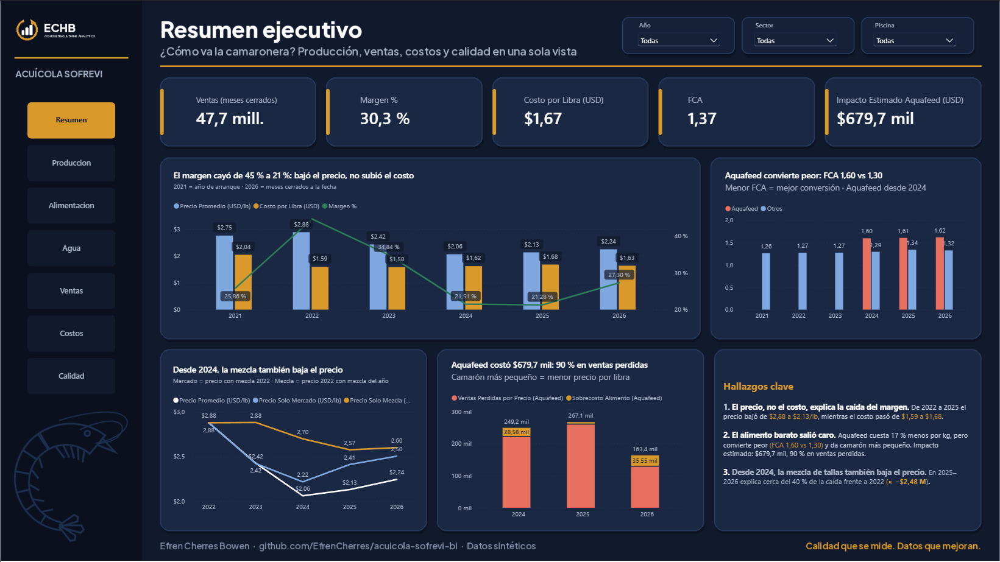

# Fase 6 · Dashboard

Dashboard en Power BI con tema oscuro, 8 páginas y navegación lateral entre páginas. Cada página responde una pregunta del negocio, y los títulos de los gráficos son la conclusión, no una descripción del gráfico.

| # | Página | Pregunta que responde | Estado |
|---|---|---|---|
| 00 | Portada | ¿De qué trata el caso? | ✅ |
| 01 | Resumen | ¿La camaronera es rentable y dónde se pierde dinero? | ✅ |
| 02 | Producción | ¿Cómo rinden las piscinas y los sectores? | 🔄 |
| 03 | Alimentación | ¿Qué tan eficiente es el alimento? | ⬜ |
| 04 | Agua | ¿La calidad del agua afecta el resultado? | ⬜ |
| 05 | Ventas | ¿Qué pasa con el precio y las tallas? | ⬜ |
| 06 | Costos | ¿Cuánto cuesta producir una libra? | ⬜ |
| 07 | Calidad de datos | ¿Qué tan confiables son los datos? | ⬜ |

**Diseño**
- Tema: `tema/Sofrevi_tema_oscuro.json`, que define colores, fuentes y deja apagados los fondos y bordes de los visuales.
- Lienzos de fondo: 1280 × 720, con el riel lateral reservado para el navegador de páginas.
- Colores con significado fijo en todo el informe:
  - Azul `#7FA7E0`: referencia o precio.
  - Ámbar `#D99A2B`: costo o dato a resaltar.
  - Coral `#E8705F`: problema (Aquafeed, pérdidas).
  - Verde `#5BBF8E`: margen.

---

## 01 · Resumen ejecutivo

### Qué contiene

**Segmentaciones:** Año, Sector y Piscina, en formato desplegable. Filtran las tarjetas y los gráficos.

**Tarjetas KPI (período completo)**

| KPI | Valor | Medida |
|---|---|---|
| Ventas (meses cerrados) | $47,7 M | `Ventas (meses cerrados)`: solo meses con gastos registrados, para comparar ventas y costos del mismo período |
| Margen % | 30,3 % | `Margen %` |
| Costo por libra | $1,67 | `Costo por Libra (USD)` |
| FCA | 1,37 | `FCA`: kg de alimento por kg de camarón, calculado por ciclo cosechado |
| Impacto estimado Aquafeed | $679,7 mil | `Impacto Estimado Aquafeed (USD)` |

**Gráficos**

| # | Título (conclusión) | Tipo | Campos |
|---|---|---|---|
| 1 | El margen cayó de 45 % a 21 %: bajó el precio, no subió el costo | Columnas agrupadas + línea | Año · Precio Promedio (USD/lb), Costo por Libra (USD) · Margen % |
| 2 | Aquafeed convierte peor: FCA 1,60 vs 1,30 | Columnas agrupadas | Año · FCA · Grupo Alimento |
| 3 | Desde 2024, la mezcla también baja el precio | Líneas | Año · Precio real, Precio Solo Mercado, Precio Solo Mezcla |
| 4 | Aquafeed costó $679,7 mil: 90 % en ventas perdidas | Columnas apiladas | Año · Ventas Perdidas por Precio, Sobrecosto Alimento |
| 5 | Hallazgos clave | Cuadro de texto | — |

### Qué se encontró

1. **El precio, no el costo, explica la caída del margen.** El margen pasó de 44,6 % (2022) a 21,3 % (2025). En ese período el precio bajó de $2,88 a $2,13 por libra, mientras el costo apenas cambió (de $1,59 a $1,68).
2. **El alimento barato salió caro.** Desde 2024 parte de las piscinas usa alimento Aquafeed, que es 17 % más barato por kg pero convierte peor: FCA 1,60–1,62 frente a 1,26–1,34 del resto de proveedores. El camarón sale más pequeño y se vende más barato. El impacto estimado es de $679,7 mil, repartido así:

   | Año | Impacto |
   |---|---|
   | 2024 | $249,2 mil |
   | 2025 | $267,1 mil |
   | 2026 (meses cerrados) | $163,4 mil |

   Cerca del 90 % del impacto son ventas perdidas por menor precio; el resto es sobrecosto de alimento.
3. **Desde 2024, la mezcla de tallas también baja el precio.** Para separar los dos efectos, el precio se descompuso con base 2022:
   - **Solo mercado:** cómo habría cambiado el precio si la mezcla de tallas siguiera igual que en 2022.
   - **Solo mezcla:** cómo habría cambiado si el precio de cada talla siguiera igual que en 2022.

   | Año | Caída total vs 2022 | Por mercado | Por mezcla |
   |---|---|---|---|
   | 2023 | −0,46 | −0,46 | 0,00 |
   | 2024 | −0,82 | −0,66 | −0,18 |
   | 2025 | −0,75 | −0,47 | −0,31 |
   | 2026 | −0,64 | −0,38 | −0,28 |

   En 2023 toda la caída fue del mercado. En 2025–2026 la mezcla explica cerca del 40 % de la caída (≈ −$2,48 M acumulado). El mercado se recupera, pero las tallas menores frenan la recuperación. Los dos efectos son una aproximación y no suman exactamente la caída total.

### Decisiones y advertencias

- **2021 es año de arranque:** hubo pocas cosechas y los costos fijos se reparten entre pocas libras. En el gráfico 1 se muestra con nota; en los gráficos 3 y 4 se excluye (el 3 usa 2022 como base y el 4 solo cubre los años con Aquafeed).
- **2026 es un año parcial:** incluye solo los meses cerrados, es decir, con gastos registrados.
- **El cuadro de hallazgos es fijo:** describe el período completo y no cambia con las segmentaciones.
- **Comprobación de cifras:** todos los números del texto se contrastaron con las etiquetas de los gráficos y con las consultas DAX de la Fase 5 (`modelo/medidas_dax.md`).
- **Línea recta en los gráficos de línea:** se usa interpolación lineal, porque la curva suavizada dibuja valores entre años que no existen.

---

*Datos sintéticos: la camaronera y sus registros son simulados.*
